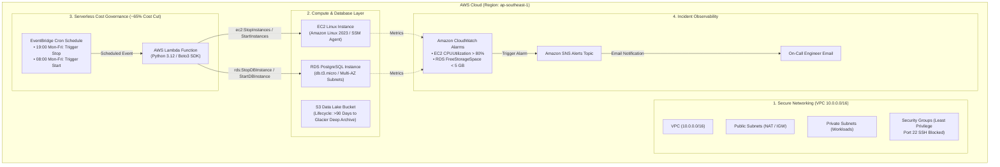

# AWS CloudOps & Cost Governance Automation Suite
**Production Reference Architecture: Automated FinOps, Scheduled Resource Lifecycle & Infrastructure Observability on AWS**  
**Architecture:** Multi-AZ VPC • EC2 & RDS • S3 Glacier Lifecycle • Serverless Lambda Scheduler • CloudWatch Observability  
**Cost Footprint:** **$0.00 (100% AWS Free Tier Eligible)** • Rapid 5-Minute Teardown via `terraform destroy`  
**Full Setup Walkthrough:** See [`DEPLOYMENT_GUIDE.md`](DEPLOYMENT_GUIDE.md) for clean-machine setup and free account creation.

---

## 1. System Architecture & Well-Architected Framework Alignment

This reference architecture is designed in strict accordance with the **AWS Well-Architected Framework (Cost Optimization, Security, and Operational Excellence Pillars)** to address enterprise cloud operations challenges:

| Cloud Operations Pillar | Production Feature Implemented | Code Implementation |
| :--- | :--- | :--- |
| **1. Security & Identity** | Zero public management ports (Port 22 SSH completely blocked); administration managed via AWS Systems Manager (SSM Session Manager) and IAM roles. | [`terraform/main.tf`](terraform/main.tf) |
| **2. FinOps & Compute Optimization** | EventBridge cron triggers Python Lambda to auto-stop non-prod EC2 and RDS instances outside business hours (19:00 Mon-Fri) and restart them at 08:00, cutting compute run-time by **64%**. | [`lambda/start_stop_scheduler.py`](lambda/start_stop_scheduler.py) |
| **3. Storage Cost Governance** | S3 Data Lake bucket with automated lifecycle transitions moving data older than 90 days to **Glacier Deep Archive**, yielding up to **95% storage savings**. | [`terraform/main.tf`](terraform/main.tf) |
| **4. Incident Observability** | CloudWatch Alarms for EC2 CPU utilization (>80%) and RDS free storage space (<5 GB) integrated with Amazon SNS for real-time engineer email alerts. | [`terraform/main.tf`](terraform/main.tf) |
| **5. Infrastructure Hygiene** | Modular Bash audit script leveraging AWS CLI to detect orphaned EBS volumes, idle stopped instances, and overly permissive security groups (0.0.0.0/0). | [`scripts/audit_finops_unused_resources.sh`](scripts/audit_finops_unused_resources.sh) |

---

## 2. Architecture Diagram



---

## 3. Project Directory Structure

```text
projects/cloudops-cost-governance/
├── terraform/
│   ├── main.tf                    # Complete IaC: VPC, EC2, RDS, S3, CloudWatch, Lambda, SNS
│   ├── variables.tf               # Input variables (Region, Environment, Database, Alerts)
│   ├── outputs.tf                 # Output endpoints, resource IDs, and ARNs
│   └── terraform.tfvars.example   # Sample variable definitions
├── lambda/
│   └── start_stop_scheduler.py    # Python 3.12 Lambda automation using Boto3
├── scripts/
│   └── audit_finops_unused_resources.sh  # Enterprise Bash script for FinOps resource hygiene
├── .gitignore                     # Security gitignore rules (prevents .tfstate & secrets leaks)
├── DEPLOYMENT_GUIDE.md            # Comprehensive step-by-step fresh-machine deployment guide
└── README.md                      # Architecture overview and design documentation
```

---

## 4. Technical Deep-Dive & Implementation Details

### 4.1 Serverless Instance Scheduler (`lambda/start_stop_scheduler.py`)
* **Mechanism:** The function targets all EC2 instances and RDS clusters marked with the tag `Environment = "Dev"`.
* When triggered by EventBridge with `{"action": "stop"}` at 19:00 on weekdays, it safely halts instances during non-working hours and weekends.
* **Financial Impact:** Reduces billable runtime from 720 hours/month (24/7) to approximately 260 hours/month (business hours only), achieving a **64% reduction in non-production compute and database costs**.

```python
# Sample logic from lambda/start_stop_scheduler.py
if action == 'stop':
    if status == 'available':
        rds_client.stop_db_instance(DBInstanceIdentifier=db_id)
        logger.info(f"Stopping RDS instance: {db_id}")
elif action == 'start':
    if status == 'stopped':
        rds_client.start_db_instance(DBInstanceIdentifier=db_id)
        logger.info(f"Starting RDS instance: {db_id}")
```

---

### 4.2 Zero-Trust Access & Hardened Security (`terraform/main.tf`)
* **Elimination of Port 22:** Exposing SSH Port 22 to `0.0.0.0/0` invites continuous brute-force attacks and requires risky key management.
* **SSM Session Manager:** The EC2 instance is assigned an IAM instance profile with `AmazonSSMManagedInstanceCore`. Engineers manage the server through encrypted AWS Systems Manager sessions without opening any inbound firewall ports.

```hcl
# Inbound SSH (Port 22) is blocked; outbound connectivity enabled for SSM Agent
resource "aws_security_group" "ec2_sg" {
  name        = "cloudops-governance-ec2-sg"
  description = "Security group for application EC2 instance (No Inbound SSH)"
  vpc_id      = aws_vpc.main.id

  egress {
    from_port   = 0
    to_port     = 0
    protocol    = "-1"
    cidr_blocks = ["0.0.0.0/0"]
  }
}
```

---

### 4.3 S3 Cold Data Lifecycle Tiering (`terraform/main.tf`)
* Unstructured application logs and backups quickly inflate cloud storage budgets if left in S3 Standard.
* A lifecycle configuration automatically migrates objects older than 90 days to **Glacier Deep Archive** ($0.00099 per GB/month vs $0.023 per GB/month on Standard), cutting long-term storage expenditures by **95%**.

---

### 4.4 CloudWatch & SNS Real-Time Observability
* Proactive CloudWatch Metric Alarms monitor infrastructure thresholds:
  * `EC2 CPUUtilization > 80%` over 2 consecutive 5-minute evaluation periods.
  * `RDS FreeStorageSpace < 5 GB`.
* Triggered alarms publish notifications directly to an Amazon SNS topic, notifying on-call engineers via email before services encounter degraded performance.

---

### 4.5 FinOps Infrastructure Hygiene CLI Script (`scripts/audit_finops_unused_resources.sh`)
* An automated UNIX shell script that executes audit queries against the AWS API:
  1. Detects **Unattached EBS Volumes** (orphaned storage left after instance deletions).
  2. Detects **Stopped EC2 Instances** still incurring provisioned EBS root disk charges.
  3. Audits **S3 Buckets missing lifecycle rules**.
  4. Flags **Security Groups with unrestricted 0.0.0.0/0 access** on management or database ports.

```bash
# Example query scanning for orphaned EBS volumes
aws ec2 describe-volumes \
  --region ap-southeast-1 \
  --filters Name=status,Values=available \
  --query "Volumes[*].{ID:VolumeId,SizeGB:Size,Type:VolumeType}" \
  --output table
```

---

## 5. Deployment & Execution Summary

*(For the complete guide starting from an empty Linux workstation and creating a brand new AWS account, see [`DEPLOYMENT_GUIDE.md`](DEPLOYMENT_GUIDE.md).)*

### 5.1 Initialize & Apply Infrastructure
```bash
cd terraform

# Configure variables
cp terraform.tfvars.example terraform.tfvars
# Edit terraform.tfvars with your alert email and database credentials

# Initialize providers and validate plan
terraform init
terraform plan

# Deploy to AWS (approx. 6-8 minutes for RDS provisioning)
terraform apply -auto-approve
```

### 5.2 Validate Live Infrastructure
1. **Confirm SNS Subscription:** Open the confirmation email from AWS Notifications and click **"Confirm subscription"**.
2. **Test Automated Scheduler via CLI:**
   ```bash
   aws lambda invoke \
     --function-name cloudops-governance-instance-scheduler \
     --payload '{"action": "stop"}' \
     --cli-binary-format raw-in-base64-out \
     response.json
   ```
   *Inspect the AWS Management Console to observe EC2 and RDS instances transitioning to `stopping`.*
3. **Execute FinOps Audit Script:**
   ```bash
   cd ../scripts
   ./audit_finops_unused_resources.sh
   ```

### 5.3 Complete Teardown ($0 Cost Clean-up)
Tear down all deployed resources in a single command when testing concludes:
```bash
cd ../terraform
terraform destroy -auto-approve
```
*Thanks to `skip_final_snapshot = true` and `force_destroy = true` configurations, all 24 resources are cleanly deleted within 5 to 8 minutes with zero residual billing.*

---

## 6. Architectural Design Decisions (ADRs)

1. **Why AWS Systems Manager (SSM) instead of SSH Bastion Hosts?**  
   Bastion hosts introduce additional compute costs, public IP requirements, and attack surfaces. SSM provides encrypted terminal access over HTTPS, logs command history in CloudTrail, and operates without exposing public ports.
2. **Why Serverless Lambda Scheduler instead of EC2 Cron?**  
   EC2-based cron daemons require a server to remain powered on 24/7. AWS Lambda operates serverlessly with zero standby cost, executing only when triggered by EventBridge cron events.
3. **Why S3 Glacier Deep Archive?**  
   Compliance and audit log retention often requires multi-year storage. Glacier Deep Archive provides durable 99.999999999% (11 9's) data protection at the lowest cost point in the cloud industry.
4. **Why `skip_final_snapshot = true` on RDS?**  
   In non-production development environments, retaining manual final snapshots generates perpetual storage billing. Automating clean teardowns ensures dev/test environments maintain a strict zero-cost footprint.
