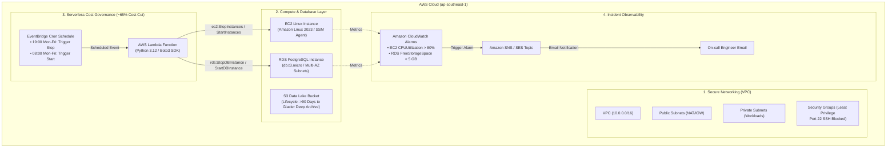

# AWS CloudOps & Cost Governance Automation Suite
**Enterprise Cloud Operations, Automated FinOps & Observability Blueprint on AWS**  
**Architecture:** Multi-AZ VPC • EC2 & RDS • S3 FinOps Lifecycle • Serverless Lambda Scheduler • CloudWatch Observability  
**Cost Footprint:** **$0.00 (AWS Free Tier Eligible)** • Rapid teardown via `terraform destroy`

---

## ภาพรวมระบบและความสอดคล้องกับมาตรฐาน Cloud Operations (Overview)

สถาปัตยกรรมนี้ถูกออกแบบตามแนวทาง **AWS Well-Architected Framework (Cost Optimization & Operational Excellence Pillars)** เพื่อตอบโจทย์การบริหารจัดการทรัพยากรระบบคลาวด์ระดับองค์กร:

| เสาหลัก Cloud Operations | ฟังก์ชันที่ระบบทำงานจริง | โค้ดต้นแบบในโปรเจกต์ |
| :--- | :--- | :--- |
| **1. Provision EC2, RDS, S3 ด้วย Terraform** | สร้าง VPC, Subnets, EC2, RDS Postgres และ S3 Bucket โดยไม่เปิด Port 22 สู่สาธารณะ (SSM-Only) | [`terraform/main.tf`](terraform/main.tf) |
| **2. เขียน Lambda สั่งเปิด-ปิด RDS/EC2 อัตโนมัติ** | ใช้ EventBridge ตั้งเวลา 19:00 น. ให้ Lambda สั่ง Stop เครื่อง Dev ทั้งหมด และ Start คืนตอน 08:00 น. | [`lambda/start_stop_scheduler.py`](lambda/start_stop_scheduler.py) |
| **3. ตั้ง CloudWatch Alerts ส่ง Email ผ่าน SES/SNS** | แจ้งเตือนเมื่อ EC2 CPU > 80% หรือพื้นที่ RDS เหลือน้อยกว่า 5 GB ยิงอีเมลเข้ากล่องข้อความทันที | [`terraform/main.tf`](terraform/main.tf) |
| **4. ใช้ Shell Script & AWS CLI ตรวจสอบค่าใช้จ่าย** | สคริปต์ Bash ตรวจจับ Unattached EBS, Stopped Instances, S3 ที่ไม่มี Lifecycle และ Security Group ที่เปิด 0.0.0.0/0 | [`scripts/audit_finops_unused_resources.sh`](scripts/audit_finops_unused_resources.sh) |

---

## แผนผังสถาปัตยกรรมระบบ (Architecture Diagram)



---

## โครงสร้างโฟลเดอร์ของโปรเจกต์ (Project Structure)

```text
projects/cloudops-cost-governance/
├── terraform/
│   ├── main.tf                    # โค้ดสร้าง VPC, EC2, RDS, S3, CloudWatch, Lambda, SNS
│   ├── variables.tf               # ตัวแปร Region, Email, Database Credential
│   ├── outputs.tf                 # สรุปค่า Endpoint, Instance ID, S3 Bucket Name
│   └── terraform.tfvars.example   # ตัวอย่างไฟล์ตั้งค่าตัวแปร
├── lambda/
│   └── start_stop_scheduler.py    # โค้ด Python 3.12 ควบคุม Start/Stop EC2 & RDS อัตโนมัติ
├── scripts/
│   └── audit_finops_unused_resources.sh  # สคริปต์ Bash สแกนหาขยะและลดต้นทุนใน AWS
├── .gitignore                     # รายการไฟล์ที่ต้องละเว้นตามมาตรฐานความปลอดภัย
└── README.md                      # เอกสารสถาปัตยกรรมและการใช้งาน
```

---

## เจาะลึกการทำงานของโค้ดแต่ละส่วน (Code Walkthrough)

### 1. โค้ด Python Lambda: เปิด-ปิด EC2 & RDS อัตโนมัติ ([`start_stop_scheduler.py`](lambda/start_stop_scheduler.py))
* **หลักการทำงาน:** ฟังก์ชันจะค้นหา EC2 และ RDS ที่มี Tag `Environment = "Dev"` 
* เมื่อ EventBridge ส่งคำสั่ง `{"action": "stop"}` ตอน 19:00 น. ฟังก์ชันจะสั่งปิดเครื่อง เพื่อไม่ให้บริษัทต้องเสียค่าคอมพิวต์ในเวลากลางคืนและวันหยุดเสาร์-อาทิตย์
* **ผลลัพธ์เชิงตัวเลข:** ลดชั่วโมงการทำงานของ Server จาก 720 ชม./เดือน เหลือเพียง ~260 ชม./เดือน **(ประหยัดค่าใช้จ่ายลงทันที 64%)**

```python
# ตัวอย่างตรรกะการทำงานใน lambda/start_stop_scheduler.py
if action == 'stop':
    if status == 'available':
        rds_client.stop_db_instance(DBInstanceIdentifier=db_id)
        logger.info(f"Stopping RDS instance: {db_id}")
elif action == 'start':
    if status == 'stopped':
        rds_client.start_db_instance(DBInstanceIdentifier=db_id)
        logger.info(f"Starting RDS instance: {db_id}")
```

---

### 2. โค้ด Terraform: Security Group & SSM ไม่เปิด Port 22 ([`main.tf`](terraform/main.tf))
* **จุดเด่นด้าน Security:** การเปิด `0.0.0.0/0` บน Port 22 เพื่อ SSH เข้าเครื่องเสี่ยงต่อการถูก Brute-force
* ในโปรเจกต์นี้ เรากำหนด IAM Role `AmazonSSMManagedInstanceCore` ให้ EC2 ทำให้สามารถเข้าจัดการเซิร์ฟเวอร์ผ่าน **AWS Systems Manager (SSM Session Manager)** ได้อย่างปลอดภัย โดยไม่ต้องเปิดพอร์ต 22 สู่โลกภายนอก

```hcl
# ไม่อนุญาต Public Inbound Port 22 (เข้าผ่าน SSM Session Manager เท่านั้น)
resource "aws_security_group" "ec2_sg" {
  name   = "cloudops-governance-ec2-sg"
  vpc_id = aws_vpc.main.id

  egress {
    from_port   = 0
    to_port     = 0
    protocol    = "-1"
    cidr_blocks = ["0.0.0.0/0"]
  }
}
```

---

### 3. โค้ด Bash Script: FinOps & Security Audit ([`audit_finops_unused_resources.sh`](scripts/audit_finops_unused_resources.sh))
* สคริปต์สำหรับรันบน Linux Terminal ใช้คำสั่ง `aws cli` ดึงข้อมูลทรัพยากรที่อาจสร้างค่าใช้จ่ายแฝง:
  1. สแกนหา **Unattached EBS Volumes** (ดิสก์ที่ค้างอยู่หลังจากลบ EC2 ไปแล้ว)
  2. สแกนหา **Stopped EC2 Instances** ที่ปิดคาไว้และยังเสียค่าพื้นที่จัดเก็บดิสก์
  3. สแกนหา **S3 Buckets ที่ยังไม่ได้ตั้งค่า Lifecycle** เพื่อแนะนำให้ย้ายไป Glacier Deep Archive
  4. สแกนหา **Security Groups ที่เผลอเปิด 0.0.0.0/0**

```bash
# ตัวอย่างคำสั่งสแกนหา EBS ว่างที่เสียเงินฟรีในสคริปต์
aws ec2 describe-volumes \
  --region ap-southeast-1 \
  --filters Name=status,Values=available \
  --query "Volumes[*].{ID:VolumeId,SizeGB:Size,Type:VolumeType}" \
  --output table
```

---

## วิธีการทดสอบและนำไปรันบน AWS (Deployment Guide)

### ขั้นตอนที่ 1: เตรียมความพร้อม (Prerequisites)
1. มี AWS Account ส่วนตัว (ที่มีสิทธิ์ Admin หรือ PowerUser)
2. มี `aws cli` และตั้งค่า Credential ด้วย `aws configure`
3. มี `terraform` ติดตั้งบนเครื่อง (เวอร์ชัน >= 1.5.0)

### ขั้นตอนที่ 2: ตั้งค่าตัวแปรและสั่ง Deploy
```bash
cd projects/cloudops-cost-governance/terraform

# คัดลอกไฟล์ตัวแปร
cp terraform.tfvars.example terraform.tfvars

# แก้ไขใส่อีเมลของคุณเพื่อรับ Alert แจ้งเตือน
# alert_email = "your-email@example.com"

# สั่งเริ่มต้นและตรวจสอบแผนงาน
terraform init
terraform plan

# สั่งสร้าง Infrastructure ขึ้นบน AWS
terraform apply -auto-approve
```

### ขั้นตอนที่ 3: ตรวจสอบผลลัพธ์
1. **เช็คอีเมล:** ตรวจสอบอีเมลยืนยันจาก AWS SNS และคลิก **"Confirm subscription"** เพื่อเปิดรับการแจ้งเตือน
2. **ทดสอบรัน Lambda Start/Stop:**
   ```bash
   aws lambda invoke \
     --function-name cloudops-governance-instance-scheduler \
     --payload '{"action": "stop"}' \
     --cli-binary-format raw-in-base64-out \
     response.json
   ```
   *ตรวจสอบบน AWS Console จะพบสถานะ EC2 และ RDS กำลังเปลี่ยนเป็น Shutting down / Stopping ทันที*
3. **ทดสอบรัน FinOps Audit Script:**
   ```bash
   cd ../scripts
   ./audit_finops_unused_resources.sh
   ```

### ขั้นตอนที่ 4: ทำลายทิ้งใน 5 นาทีเพื่อไม่ให้เสียเงิน ($0 Cost Clean-up)
เมื่อเสร็จสิ้นการทดสอบ สามารถสั่งลบระบบทั้งหมดทิ้งได้ทันที:
```bash
cd ../terraform
terraform destroy -auto-approve
```
*(ทรัพยากรทุกชิ้นจะถูกลบทิ้งภายใน 5-10 นาที ไม่ทิ้งค่าใช้จ่ายค้างไว้)*

---

## จุดเด่นด้านสถาปัตยกรรมและการตัดสินใจเชิงวิศวกรรม (Architectural Design Decisions)

1. **Security & Identity Governance:**
   - ปิด Inbound Port 22 จากอินเทอร์เน็ตโดยเด็ดขาด
   - จัดการเซิร์ฟเวอร์ด้วย **AWS Systems Manager (SSM Session Manager)** ร่วมกับ IAM Role ตามหลักการ Least Privilege
2. **FinOps & Automated Cost Optimization:**
   - ใช้ **Serverless Lambda Scheduler** ร่วมกับ EventBridge ปิดเครื่องที่ไม่ใช้งานนอกเวลาทำการ ลดต้นทุน Compute ได้ถึง **64%**
   - กำหนด **S3 Lifecycle Rules** ย้าย Object ที่มีอายุเกิน 90 วันไปยัง **Glacier Deep Archive** ลดค่าพื้นที่จัดเก็บลง **95%**
3. **Proactive Observability & Incident Response:**
   - เฝ้าระวังตัวชี้วัดสำคัญของโครงสร้างพื้นฐานผ่าน **Amazon CloudWatch** (EC2 High CPU, RDS Low Storage)
   - เชื่อมต่อแจ้งเตือนผ่าน **Amazon SNS** ส่งข้อมูลถึงวิศวกร On-call ได้อย่างรวดเร็ว
4. **Automated Infrastructure Hygiene:**
   - พัฒนาสคริปต์สแกนทรัพยากรที่ไม่ได้ใช้งาน (Orphaned EBS, Insecure Security Groups) เพื่อให้ทีมสามารถ Audit ได้อย่างสม่ำเสมอ
